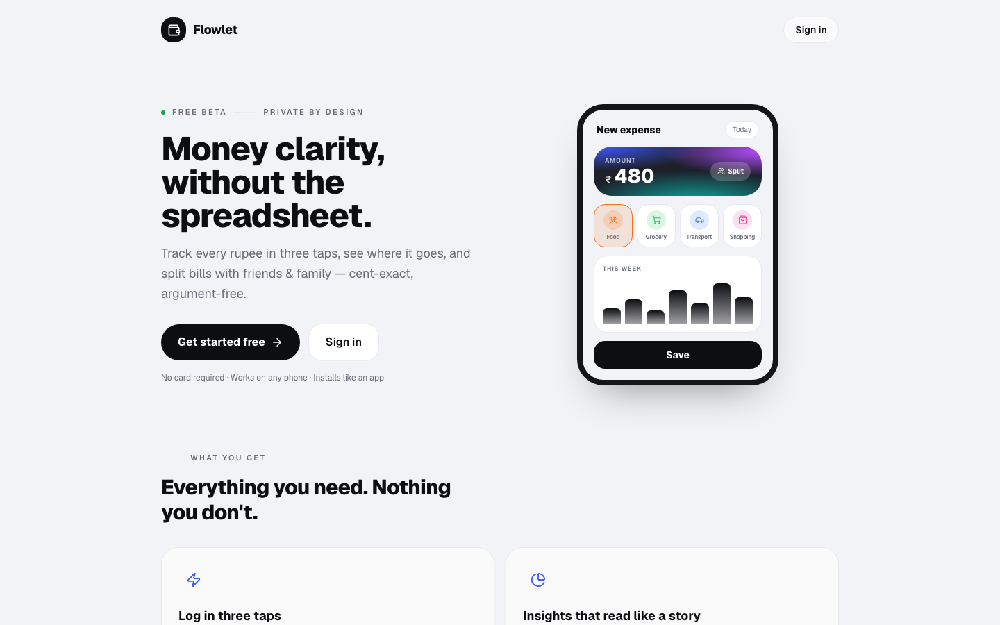
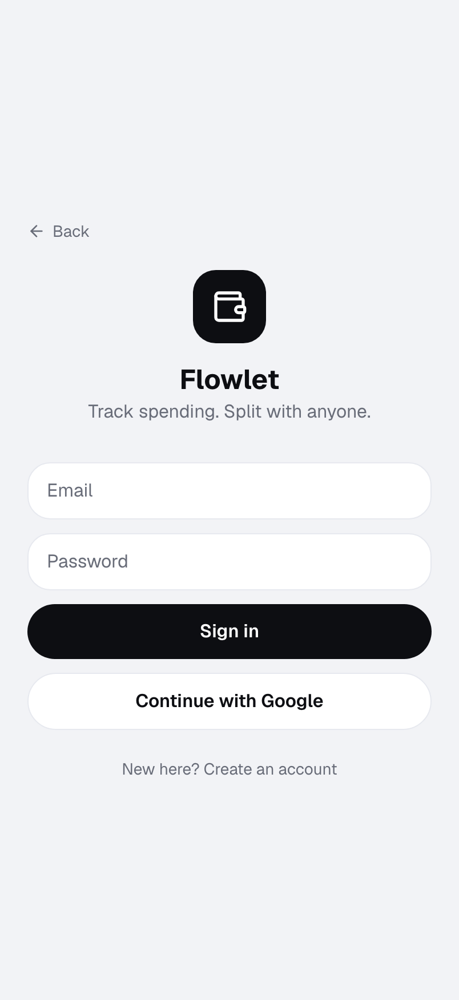
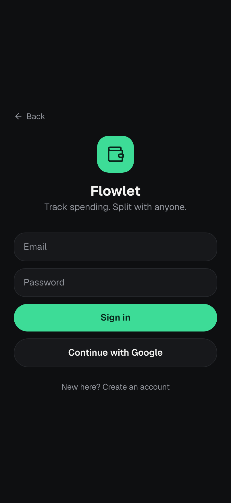

# Flowlet

**Track spending. Split with anyone.**

A privacy-first expense tracker for Indian households: fast expense logging, Splitwise-style bill splitting, medicine stock tracking for caregivers, and automatic import of bank card alerts. Installable PWA plus a native iOS app (Expo). Live at [flowlet-dev.web.app](https://flowlet-dev.web.app).



<p>
  
  
</p>

## Features

**Expenses**
- **Three-tap entry:** amount, category, done. Numpad sheet, custom categories with icon and colour.
- **History:** month / all / custom-range views with totals and a daily spend chart; tap any entry to edit.
- **Insights:** monthly and yearly category breakdowns, proportion bars, change vs. the previous period.

**Splits**
- **Groups with real accounts,** invited by email.
- **Five split methods:** equal (with per-person include toggles), exact amounts, percentages, shares, and +/− adjustments. Paise-exact: shares always sum to the total.
- **Balances, settle-up and debt simplification.**
- **Activity history and Friends view:** every shared expense shows whether you lent or borrowed; pairwise balances with each person across all groups; any shared expense can be edited.

**Medicines (for caregivers)**
- Per-person medicine lists with dose schedules (morning / afternoon / evening / night, or weekly on a fixed day).
- Run-out forecasting with colour-coded days-left, and a "refill soon" section.
- **Order list** builder that computes exactly how much to buy until a chosen date, ready to copy or share to WhatsApp.
- **Stock in** to update every medicine at once after a pharmacy run, and **monthly cost** from pack MRP vs. what you pay.
- Native app: local refill and dose reminders (no server needed).

**Automatic import**
- Google Apps Script that reads bank card alert emails and creates expenses: AU Bank, SBI Card, Axis Bank, ICICI (debit and credit). Per-message dedupe, manual-entry duplicate guard, keyword category rules. See [docs/GMAIL_SYNC.md](docs/GMAIL_SYNC.md).

**App**
- Offline-first installable PWA; Clean light and Premium dark themes; ₹ INR default with multi-currency groups.

## Security & privacy

- **Optional end-to-end encryption:** expense and medicine notes are encrypted on the device (PBKDF2 → AES-256-GCM, WebCrypto). The server only stores ciphertext; a recovery code is shown once.
- **Email verification enforced in Firestore rules,** not just the UI.
- Personal data readable only by its owner; group data only by members; group joins require a pending invite (validated in rules).
- The Firebase web config in this repo is public by design; access is controlled entirely by `firestore.rules`.

## Stack

| Layer | Tech |
| --- | --- |
| Web | React 18 + TypeScript + Vite, Tailwind CSS, lucide-react, Recharts, Geist |
| Native | React Native + Expo (iOS), expo-notifications, expo-secure-store |
| Data | Firestore realtime listeners, TanStack Query, Zustand |
| Backend | Firebase Auth (email + Google), Cloud Firestore, Firebase Hosting |
| PWA | vite-plugin-pwa (service worker, manifest, icons) |

## Getting started

```bash
npm install
cp .env.example .env.local   # fill in your Firebase web config
npm run dev
```

No Firebase project yet? Run against the emulator:

```bash
npm run emulators            # auth :9877, firestore :8567, ui :4173
VITE_USE_EMULATOR=true npm run dev
```

Native app (`native/`):

```bash
cd native && npm install
npx expo start --ios
```

### Scripts

| Command | What it does |
| --- | --- |
| `npm run dev` | Vite dev server |
| `npm run build` | Typecheck + production build to `dist/` |
| `npm test` | Vitest unit tests (split math, medicine forecasting, crypto) |
| `npm run emulators` | Firebase emulator suite |
| `node scripts/gen-icons.mjs` | Regenerate PWA icons |

### Deploy your own copy

Runs on Firebase's free tier.

```bash
npm run build
firebase deploy --only hosting,firestore:rules --project <your-project>
```

## Project layout

```
src/
  components/        AppLayout (dock nav), BottomSheet
  features/
    auth/            AuthContext, SignIn, VerifyEmail
    categories/      hooks, icons, Add/Manage sheets
    expenses/        EntryScreen, History, Edit sheet
    groups/          groups, invites, activity, friends
    insights/        charts
    meds/            medicines, forecasting, order/stock-in/cost sheets
    split/           SplitEditor, splitCalc, balances (+ tests)
    vault/           end-to-end encryption
  lib/               firebase init, crypto, types, theme, utils
native/              Expo iOS app
scripts/             Gmail sync (Apps Script), icon generator
firestore.rules      security rules
```

## Roadmap

- SMS-based automatic import on iPhone (iOS Shortcuts + a small server function)
- More bank parsers (HDFC, Kotak, Paytm) with fixture tests
- Native app: groups and splits, home-screen widget, receipt photo OCR
- Budgets and recurring expenses

## License

[MIT](LICENSE)
